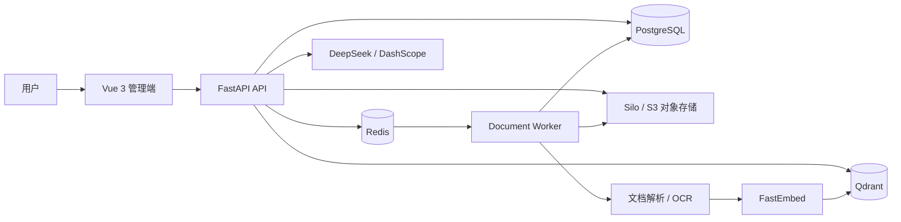

<div align="center">

# Enterprise RAG Knowledge Platform

### 企业级 RAG 知识管理与智能问答平台

基于 **FastAPI + Vue 3** 构建，覆盖文档入库、混合检索、AI 问答、知识空间和企业级权限管理。

[](https://github.com/rowan766/python-ai-agent/stargazers)
[](https://github.com/rowan766/python-ai-agent/forks)
[](https://github.com/rowan766/python-ai-agent/issues)

[](https://www.python.org/)
[](https://fastapi.tiangolo.com/)
[](https://vuejs.org/)
[](https://www.docker.com/)

如果这个项目对你有帮助，请点击右上角的 **Star ⭐**。你的支持会让项目持续完善，也能帮助更多开发者发现它。

[快速开始](#快速开始) · [核心能力](#核心能力) · [项目架构](#项目架构) · [参与贡献](#参与贡献)

</div>

---

## 项目简介

本项目面向企业内部知识管理与智能检索场景，将非结构化文档转化为可检索的知识资产，并通过 RAG（Retrieval-Augmented Generation，检索增强生成）提供带上下文的 AI 问答能力。

它不仅包含文档解析、向量检索和大模型调用，还实现了用户、角色、菜单、部门、数据范围和知识空间 ACL，可作为企业知识库、内部文档助手、客服知识中台或 RAG 应用脚手架。

## 为什么选择它

- **完整 RAG 链路**：上传、对象存储、解析、分块、Embedding、向量入库、混合检索、答案生成一体化。
- **企业权限模型**：平台 RBAC、部门数据范围和知识空间 ACL 三层权限控制。
- **异步文档处理**：Redis 队列与独立 Worker 解耦耗时任务，避免阻塞 API 服务。
- **多格式解析**：覆盖文本、PDF、Office、表格和图片 OCR 等常见企业文件。
- **本地开发友好**：基础设施运行在 Docker，前后端与 Worker 在本机热更新。
- **可替换模型服务**：支持 DeepSeek 与阿里云 DashScope 的 OpenAI 兼容接口。

## 核心能力

### RAG 与文档处理

- 文档上传、下载、预览、状态跟踪和任务管理。
- 语义分块与重叠窗口，支持自定义 Chunk 参数。
- FastEmbed 本地 CPU 向量化，无需单独部署 Embedding 服务。
- Qdrant 向量检索与关键词检索融合，支持精确匹配加权和相关度阈值。
- 基于检索上下文生成回答，并保留引用片段。
- 无有效检索上下文时可切换为通用 AI 对话。
- Redis 队列驱动的独立文档处理 Worker。

### 企业权限与管理

- 用户、角色、菜单、按钮和部门管理。
- 全部、本部门、本部门及下属、仅本人四级数据范围。
- Owner、Manager、Editor、Viewer 四级知识空间角色。
- 私有、部门、部门树、指定共享、全员可见五种空间可见性。
- 按部门、角色、用户进行知识空间共享。
- JWT 登录、Redis Token 黑名单和 SVG 图片验证码。

### 支持的文件格式

| 分类 | 格式 |
| --- | --- |
| 文本 | `txt`、`md`、`markdown`、`csv`、`json`、`log`、`yaml`、`yml`、`xml`、`html`、`htm` |
| 文档 | `pdf`、`docx`、`pptx` |
| 表格 | `xlsx`、`xls` |
| 图片/OCR | `png`、`jpg`、`jpeg`、`bmp`、`gif`、`webp`、`tif`、`tiff` |

## 项目架构



### 文档处理流程

```text
上传文件
   ↓
Silo 保存原始文件 + PostgreSQL 创建元数据
   ↓
Redis 文档任务队列
   ↓
Worker 提取文本 / OCR / Office 解析
   ↓
语义分块（Chunk + Overlap）
   ↓
FastEmbed 生成向量
   ↓
Qdrant 写入向量 + PostgreSQL 写入分块元数据
   ↓
混合检索 + LLM 生成回答
```

## 技术栈

| 模块 | 技术 |
| --- | --- |
| 前端 | Vue 3、Vite、Element Plus、Pinia、Vue Router、Axios、Marked |
| 后端 | FastAPI、SQLAlchemy 2、Pydantic 2、Python 3.11 |
| 数据库 | PostgreSQL 16 |
| 缓存与队列 | Redis 7 |
| 对象存储 | Silo（MinIO/S3 兼容） |
| 向量数据库 | Qdrant |
| Embedding | FastEmbed、ONNX Runtime |
| OCR | RapidOCR |
| LLM | DeepSeek、阿里云 DashScope（OpenAI 兼容接口） |
| 开发工具 | uv、pnpm、Docker Compose |

## 快速开始

以下流程适用于 Windows + Docker Desktop，本地前后端开发时支持热更新。

### 1. 环境要求

- Git
- Docker Desktop
- Python 3.11（推荐由 `uv` 管理）
- Node.js 20+
- uv
- pnpm（可通过 Corepack 启用）

### 2. 克隆项目

```powershell
git clone https://github.com/rowan766/python-ai-agent.git
cd python-ai-agent
```

### 3. 创建后端配置

```powershell
Copy-Item .\backend\.env.example .\backend\.env
```

编辑 `backend/.env`，至少完成以下配置：

```env
SECRET_KEY=请替换为至少32位的随机字符串

LLM_PROVIDER=deepseek
LLM_BASE_URL=https://api.deepseek.com
DEEPSEEK_API_KEY=请填写你的DeepSeek_API_Key
LLM_MODEL_NAME=deepseek-flash
```

可使用 PowerShell 生成本地开发密钥：

```powershell
[guid]::NewGuid().ToString("N") + [guid]::NewGuid().ToString("N")
```

> 不配置 LLM API Key 时，系统仍可启动，并会降级为检索摘要模式。

### 4. 启动基础设施

```powershell
docker compose up -d postgres redis minio qdrant
```

说明：Compose 中保留 `minio` 服务名以兼容现有后端配置，实际镜像使用 Silo（MinIO/S3 兼容对象存储）。

检查服务状态：

```powershell
docker compose ps postgres redis minio qdrant
```

### 5. 安装并启动后端

```powershell
cd backend
uv sync --python 3.11
uv run python -m uvicorn app.main:app --host 0.0.0.0 --port 3101 --reload
```

看到 `Application startup complete` 表示后端启动成功。

### 6. 启动文档 Worker

打开新的 PowerShell 终端：

```powershell
cd backend
uv run python -m app.workers.document_worker
```

看到“文档处理 Worker 已启动，正在监听队列”表示 Worker 正常运行。

### 7. 安装并启动前端

打开新的 PowerShell 终端：

```powershell
corepack enable pnpm
cd frontend
pnpm install
pnpm dev
```

如果 PowerShell 禁止执行 `pnpm.ps1`，使用对应的 `.cmd` 入口：

```powershell
pnpm.cmd install
pnpm.cmd dev
```

## 访问地址

| 服务 | 地址 |
| --- | --- |
| 前端管理界面 | http://127.0.0.1:5173 |
| 后端 API 文档 | http://127.0.0.1:3101/docs |
| Silo 管理控制台 | http://127.0.0.1:9001 |
| Qdrant Dashboard | http://127.0.0.1:6333/dashboard |

### 默认开发账号

| 系统 | 账号 | 密码 |
| --- | --- | --- |
| 管理后台 | `admin` | `123456` |
| Silo 对象存储 | `minioadmin` | `minioadmin` |

> 默认密码仅用于本地开发。公开部署前必须更换全部默认凭据。

## LLM 配置

### DeepSeek（默认）

```env
LLM_PROVIDER=deepseek
LLM_BASE_URL=https://api.deepseek.com
DEEPSEEK_API_KEY=sk-xxxxxxxxxxxxxxxx
LLM_MODEL_NAME=deepseek-flash
```

- [DeepSeek API Key](https://platform.deepseek.com/api_keys)
- [DeepSeek API 文档](https://api-docs.deepseek.com/)

### 阿里云 DashScope

```env
LLM_PROVIDER=dashscope
LLM_BASE_URL=https://dashscope.aliyuncs.com/compatible-mode/v1
DASHSCOPE_API_KEY=sk-xxxxxxxxxxxxxxxx
LLM_MODEL_NAME=qwen-plus
```

- [阿里云百炼 API Key](https://bailian.console.aliyun.com/cn-beijing/model/settings/api-key)

> API Key 属于敏感信息，请只保存在本地 `.env` 或安全的密钥管理服务中，不要提交到 Git。

## Embedding 与检索配置

默认使用 FastEmbed 在本地 CPU 上生成向量：

```env
EMBEDDING_PROVIDER=fastembed
EMBEDDING_MODEL_NAME=sentence-transformers/paraphrase-multilingual-MiniLM-L12-v2
EMBEDDING_VECTOR_SIZE=384
EMBEDDING_FALLBACK_TO_HASH=true
```

常用 RAG 参数：

```env
DOCUMENT_CHUNK_SIZE=800
DOCUMENT_CHUNK_OVERLAP=120
RETRIEVAL_DEFAULT_LIMIT=8
RETRIEVAL_CANDIDATE_LIMIT=24
RETRIEVAL_KEYWORD_WEIGHT=0.22
RETRIEVAL_EXACT_MATCH_BONUS=0.08
RETRIEVAL_RELEVANCE_THRESHOLD=0.3
RAG_ANSWER_MAX_CHUNKS=4
RAG_ANSWER_MAX_CONTEXT_CHARS=2400
```

> 更换 Embedding 模型或向量维度后，旧向量不再兼容，需要重建 Qdrant Collection 并重新处理文档。

## 项目结构

```text
python-ai-agent/
├── backend/
│   ├── app/
│   │   ├── api/                 # FastAPI 路由
│   │   ├── core/                # 配置、数据库、Redis、安全组件
│   │   ├── services/            # 文档、检索、LLM、对象存储服务
│   │   ├── workers/             # 文档处理 Worker
│   │   ├── main.py              # FastAPI 入口
│   │   ├── models.py            # SQLAlchemy 模型
│   │   └── schemas.py           # Pydantic Schema
│   ├── .env.example
│   ├── pyproject.toml
│   └── uv.lock
├── frontend/
│   ├── src/
│   │   ├── api/                 # API 请求封装
│   │   ├── layout/              # 后台布局
│   │   ├── router/              # 路由与权限守卫
│   │   ├── stores/              # Pinia 状态管理
│   │   └── views/               # 业务页面
│   ├── package.json
│   └── pnpm-lock.yaml
├── docker-compose.yml
├── 部署方案.md
└── README.md
```

## 常用命令

```powershell
# 查看基础设施状态
docker compose ps

# 查看某个基础设施服务日志
docker compose logs -f postgres
docker compose logs -f redis
docker compose logs -f minio
docker compose logs -f qdrant

# 停止基础设施容器（保留数据卷）
docker compose down

# 启动后端开发服务
cd backend
uv run python -m uvicorn app.main:app --host 0.0.0.0 --port 3101 --reload

# 启动文档 Worker
cd backend
uv run python -m app.workers.document_worker

# 启动前端开发服务
cd frontend
pnpm.cmd dev
```

## 生产部署检查清单

- [ ] 替换 `SECRET_KEY`、数据库密码和对象存储密码。
- [ ] 将 `ALLOWED_ORIGINS` 限制为真实生产域名。
- [ ] 使用 HTTPS 和反向代理暴露前后端服务。
- [ ] 不对公网直接开放 PostgreSQL、Redis、Qdrant 和对象存储管理端口。
- [ ] 使用密钥管理服务保存 LLM API Key，不提交 `.env`。
- [ ] 设置 `EMBEDDING_FALLBACK_TO_HASH=false`，避免生产环境静默降级。
- [ ] 为 PostgreSQL、Qdrant 和对象存储建立备份策略。
- [ ] 修改或禁用默认管理员账号与默认密码。
- [ ] 根据业务量设置日志、监控、限流和告警。

## 常见问题

### 为什么 AI 问答显示“请稍后再试”？

查看 FastAPI 后端终端日志。常见原因包括 LLM API Key 无效、账户余额不足、模型名称错误或网络无法访问模型服务。

### 为什么 Worker 启动后一直没有输出？

这是正常现象。Worker 使用 Redis 阻塞队列等待文档任务，上传并提交文档处理任务后才会继续输出。

### 第一次处理文档为什么较慢？

FastEmbed、ONNX Runtime 或 OCR 组件可能需要首次初始化或下载模型，后续处理通常会更快。

### 可以只运行 Docker 基础设施吗？

可以。本地开发推荐只在 Docker 中运行 PostgreSQL、Redis、Silo 和 Qdrant，前端、后端与 Worker 在本机运行以获得热更新体验。

## 参与贡献

欢迎提交 Issue、功能建议和 Pull Request：

1. Fork 本仓库。
2. 创建功能分支：`git checkout -b feature/your-feature`。
3. 提交变更：`git commit -m "feat: add your feature"`。
4. 推送分支：`git push origin feature/your-feature`。
5. 创建 Pull Request，并说明变更目的与验证方式。

如果你发现 Bug，请在 [Issues](https://github.com/rowan766/python-ai-agent/issues) 中提供复现步骤、环境信息和相关日志，注意先移除 API Key 等敏感内容。

## 支持项目

如果这个项目帮助你理解或搭建了企业级 RAG 系统，欢迎：

- 点击右上角 **Star ⭐**，让更多人看到这个项目。
- Fork 项目并参与改进。
- 提交 Issue 分享你的使用场景和建议。
- 将项目推荐给正在研究 RAG、知识库或 FastAPI + Vue 的朋友。

<div align="center">

**你的每一个 Star，都是项目继续前进的动力。感谢支持！**

[⭐ Star this repository](https://github.com/rowan766/python-ai-agent)

</div>
